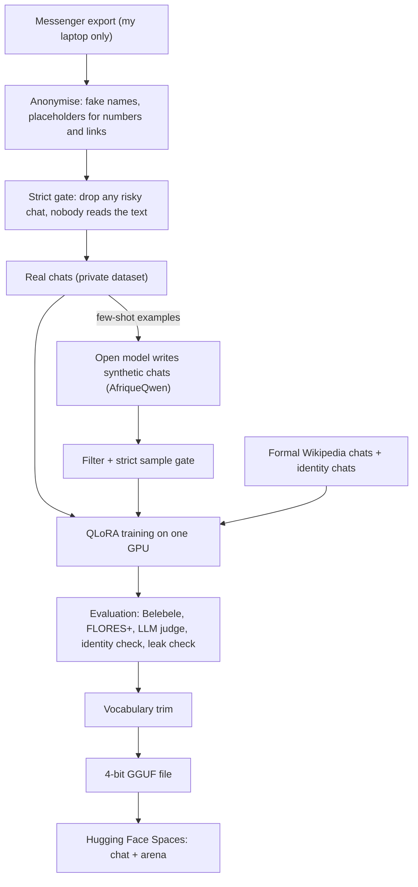
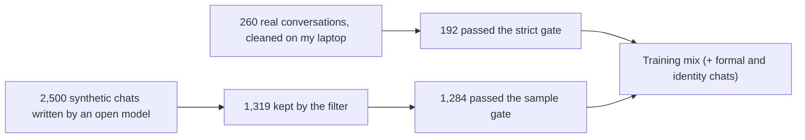
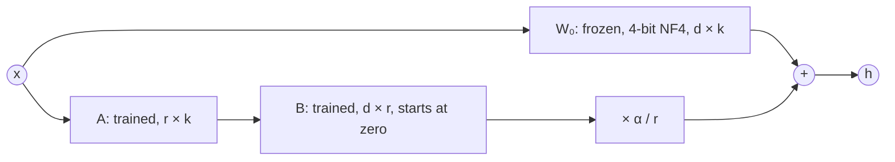

# fy-m1

An open AI model that chats in everyday Malagasy — the way people really text, not like a government letter.

"fy" means sweet or pleasant in Malagasy. M is for Malagasy. 1 is the first version.

**[Try it](#try-it)** · [Paper](paper/fym1.tex) · [Model card](MODEL_CARD.md) · [Roadmap](#roadmap) ·
[Help me rate](https://huggingface.co/spaces/Fan1000-Prog/fy-m1-arena)

> **Status: v0.1.** *pending* means not measured yet. Coming in v0.2: the full panel's blind human
> ratings, each model's answer to each test prompt, and the layer-pruning experiment.

## What it is

Open models that "speak Malagasy" often sound stiff and formal, or half-translated from French or English.
Say "Salama e!" and you get a speech back.

Real Malagasy texting is different:

- French words mix in all the time, even French verbs used the Malagasy way ("lancer-na").
- Spelling is short and phonetic ("zany" for "izany", "bé", "ahn").
- Replies are short, friendly, a bit teasing, with emoji.

fy-m1 aims for that style. Mixing Malagasy and French is correct here. A reply only counts as "drifting"
if it is fully French or English with no Malagasy at all.

fy-m1 is not a frontier model. The goal is simple: clearly and measurably better than its base model at
everyday Malagasy chat, trained on one rented GPU and shared under an open licence.

## Try it

- **Chat with it:** [fy-m1-chat](https://huggingface.co/spaces/Fan1000-Prog/fy-m1-chat) — free, no login.
  Try "Salama e!" or "Inona no vaovao?".
- **Download the model:** <!-- n:model-repo -->Fan1000-Prog/fy-m1-9B<!-- /n --> on
  [Hugging Face](https://huggingface.co/Fan1000-Prog).
  The GGUF file runs with llama.cpp and Ollama.
- **Read the paper:** [paper/fym1.tex](paper/fym1.tex) (LaTeX source; build the PDF with `tectonic`, see [How to reproduce](#how-to-reproduce))
- **Help me rate (native speakers):** [fy-m1-arena](https://huggingface.co/spaces/Fan1000-Prog/fy-m1-arena) —
  read two answers, pick the more natural one. No login.

## Results

Every number here comes from a file in [`results/`](results/), written by a script in this repo. Nothing is
typed by hand.

<!-- numbers:start -->
| Measure | Base model | fy-m1 |
|---|---|---|
| Replies that drift to full French/English (lower is better) | pending | pending |
| Naturalness, LLM judge, 1-5 | pending | pending |
| Correctness, LLM judge, 1-5 | pending | pending |
| Belebele Malagasy reading (accuracy) | pending | pending |
| FLORES chrF++ Malagasy to English | pending | pending |
| FLORES chrF++ English to Malagasy | pending | pending |
| Blind human votes so far (early votes): fy-m1 win rate | - | pending |
<!-- numbers:end -->

- The base model is <!-- n:base-model -->McGill-NLP/AfriqueQwen3.5-9B-50Langs-Instruct-v1<!-- /n -->.
- Leak check: <!-- n:leak-matches -->pending<!-- /n --> matched 8-word runs,
  <!-- n:leak-rejected -->pending<!-- /n --> rejected. Release needs zero rejected.
- Blind human votes are early votes only: <!-- n:arena-votes -->pending<!-- /n --> votes from
  <!-- n:arena-raters -->pending<!-- /n --> raters at release. The full panel's numbers come in v0.2.
- The LLM judge is a cheap extra signal. Native speakers are the real judges.

Where each number comes from:

| File | What |
|---|---|
| [`results/model_selection.json`](results/model_selection.json), [`results/greeting_gate.json`](results/greeting_gate.json) | Base-model comparison |
| [`results/data_stats.json`](results/data_stats.json), [`results/data_gate.json`](results/data_gate.json) | Data counts (counts only, never text) |
| `results/train_log.json` | Training settings and loss |
| `results/eval/` | Automatic scores, judge scores, leak check, arena votes |
| `results/shrink.json` | Model size before and after trimming |

## How the base model was chosen

I tested open chat models that fit training on one 16 GB T4 GPU (the free GPU on Kaggle and Colab). fy-m1 must ship under a simple open
licence, so the base needs one too.

| | AfriqueQwen3.5-9B-Instruct | Gemma 4 12B | Gemma 3 12B (baseline only) |
|---|---|---|---|
| FLORES+ English to Malagasy (chrF++) | <!-- n:sel-qwen-chrf-en-mg -->49.7<!-- /n --> | <!-- n:sel-gemma4-chrf-en-mg -->pending<!-- /n --> | <!-- n:sel-gemma3-chrf-en-mg -->36.8<!-- /n --> |
| FLORES+ Malagasy to English (chrF++) | <!-- n:sel-qwen-chrf-mg-en -->56.2<!-- /n --> | <!-- n:sel-gemma4-chrf-mg-en -->pending<!-- /n --> | <!-- n:sel-gemma3-chrf-mg-en -->51.8<!-- /n --> |
| Belebele reading, chat format | <!-- n:sel-qwen-belebele-chat -->74.2%<!-- /n --> | <!-- n:sel-gemma4-belebele-chat -->75.0%<!-- /n --> | <!-- n:sel-gemma3-belebele-chat -->75.1%<!-- /n --> |
| Greeting gate, blind judge mean (1-5) | <!-- n:greet-qwen-mean -->2.90<!-- /n --> | <!-- n:greet-gemma4-mean -->2.85<!-- /n --> | <!-- n:greet-gemma3-mean -->1.90<!-- /n --> |
| Greeting answers in Malagasy | <!-- n:greet-qwen-malagasy -->95.0%<!-- /n --> | <!-- n:greet-gemma4-malagasy -->90.0%<!-- /n --> | <!-- n:greet-gemma3-malagasy -->80.0%<!-- /n --> |
| Training speed on a T4 (seconds per step) | <!-- n:sel-qwen-sec-step -->83.3<!-- /n --> | <!-- n:sel-gemma4-sec-step -->pending<!-- /n --> | <!-- n:sel-gemma3-sec-step -->122.4<!-- /n --> |
| Licence | <!-- n:sel-qwen-license -->CC-BY-4.0<!-- /n --> | <!-- n:sel-gemma4-license -->Apache-2.0<!-- /n --> | <!-- n:sel-gemma3-license -->Gemma Terms of Use<!-- /n --> |

Winner: AfriqueQwen3.5-9B-Instruct. Of the models measured so far, it translates English into Malagasy
best (Gemma 4's score is still pending). It ties Gemma 4 on greetings and reading, and trains in 16-bit on a T4 (Gemma 4 is expected to need slower 32-bit). Gemma 3 is only a
comparison: its terms would make fy-m1 a Gemma derivative. Full table: the paper, Table 1.

## How fy-m1 is trained

Three pictures, in plain words. The paper has the full versions (Figures 1, 2 and 4).

**1. The whole path.** Private chats never leave my laptop until they are cleaned and checked. The rest runs
on rented GPUs and free Hugging Face Spaces.



**2. How much data is left after each check.** Every check throws data away on purpose: losing a chat is
cheap, leaking a name is not. These numbers are written by `paper/make_figures.py` from `results/`.

<!-- figure:funnel:start -->

<!-- figure:funnel:end -->

**3. What QLoRA trains.** The base model stays frozen and squeezed to 4 bits. Next to each big matrix
W₀ I train two thin matrices, A and B. Their product is a small correction added to the frozen output.



$$h = W_0\,x + \frac{\alpha}{r}\,B A\,x$$

Example: one MLP matrix of the base model has <!-- n:budget-d -->12,288<!-- /n --> × <!-- n:budget-k -->4,096<!-- /n -->
= <!-- n:budget-full -->50,331,648<!-- /n --> weights. A rank-<!-- n:budget-r -->16<!-- /n --> adapter trains only
<!-- n:budget-lora -->262,144<!-- /n --> of them (<!-- n:budget-share -->0.52%<!-- /n -->). The loss counts the
assistant's replies only, so the model learns how to answer, not how to ask.

## How it was made

| Step | What I did | Why |
|---|---|---|
| Real chats | One family's Messenger export. Everyone in it agreed. Each person's side is used as the assistant in turn. | That is where the everyday style lives. |
| Cleaning | Names, nicknames, phone numbers, emails, links and handles are replaced **on my laptop**. Raw chats never go to git, the cloud or any public place. | Privacy. |
| Strict gate | No one reads the cleaned text. A script drops any conversation with a long number, a contact or too many unknown words, and replaces every word it does not know with a fake name. <!-- n:gate-kept -->192<!-- /n --> of <!-- n:gate-before -->260<!-- /n --> conversations passed. | Losing a word is cheap. Leaking a name is not. |
| Synthetic chats | An open model with a permissive licence, run by me, writes more everyday chats from cleaned examples. | Real chats are too few. No closed-model outputs. |
| Formal slice | A small set of chats from Malagasy Wikipedia. | Keeps facts and spelling. Small, so the style stays casual. |
| Identity chats | A few "who are you?" answers and polite refusals, written by me. | It says it is fy-m1, made by Fan's lab, and refuses harmful requests. Not a safety feature. |
| Training | **QLoRA** on a Colab Pro A100 GPU (paid): the model stays frozen in 4-bit and I train small add-on weights. Loss on the assistant's replies only. | A model this size fits one GPU ([QLoRA paper](https://arxiv.org/abs/2305.14314)). I train on a Colab Pro A100; the free T4 is used for the baseline and smoke tests. |
| Checkpoints | Saved to a private repo often; a new session resumes from the latest one. | Colab sessions can disconnect. |
| Test prompts | Written fresh, never taken from the chats. | So they can be public and anyone can run them. |
| Leak check | Any fy-m1 answer that shares a run of 8 words with the real chats blocks release, unless it is a generic phrase. | Privacy again. |
| Trimming | Drop tokens Malagasy, French and English never use. Ships only if it passes its checks. | A smaller download. |

## How to reproduce

You need [uv](https://docs.astral.sh/uv/), a free Kaggle or Google Colab account for the T4 steps, and
Colab Pro (paid) for training and evaluation on an A100.

```bash
git clone https://github.com/Fan1000-prog/fy-m1 && cd fy-m1
uv sync --all-groups
uv run pytest -q          # all code tests
```

Then, in order:

1. `notebooks/00_baseline.ipynb` — scores the candidate models on a free T4.
2. `notebooks/04_synth.ipynb` — writes synthetic chats with an open, permissively licensed model.
3. `notebooks/01_train.ipynb` — trains fy-m1 on a Colab Pro A100. Rerun it after a disconnect; it resumes.
4. Evaluation (Colab Pro A100): answers the test prompts, scores both models (`scripts/score.py`), exports the GGUF.
5. `notebooks/03_trim.ipynb` — vocabulary trimming and its checks.
6. Rebuild the numbers and the paper:

   ```bash
   uv run python paper/make_numbers.py --markdown README.md MODEL_CARD.md
   uv run python paper/make_figures.py --readme README.md
   cd paper && tectonic fym1.tex
   ```

The training chats are private, so you cannot retrain on the same data. You can rerun everything else,
and train on your own chats with `scripts/build_chats.py`. Kaggle and Colab steps are in
[`docs/kaggle_operator.md`](docs/kaggle_operator.md) and [`docs/colab_operator.md`](docs/colab_operator.md).

## Roadmap

Plans, not promises. In this order:

1. **v0.2:** the full panel's blind human ratings, each model's answer to each test prompt, the
   layer-pruning test, and longer training.
2. **More everyday Malagasy text.** A bigger, hand-picked set of everyday Malagasy writing, from people who
   agree to share it, cleaned with the same strict privacy checks. More real data is what fy-m1 needs most.
3. **A Malagasy speech model.** A lot of everyday Malagasy is spoken, not typed. Next comes a model that
   understands and speaks it.

## Repo layout

| Path | What |
|---|---|
| `src/fym1/data/` | Chat reader, anonymiser, strict gate, word lists, synthetic and formal chats |
| `src/fym1/eval/` | Drift metric, baseline scoring, judge rubric |
| `src/fym1/train/`, `src/fym1/shrink/` | Training helpers, vocabulary trimming |
| `scripts/` | Command-line tools (build data, score, make the selection table) |
| `notebooks/` | Kaggle / Colab notebooks (free T4: baseline, smoke tests; Colab Pro A100: training, eval) |
| `eval/prompts.jsonl` | The public test prompts |
| `spaces/chat`, `spaces/arena` | The demo and the rating app on Hugging Face |
| `paper/` | The paper; `make_numbers.py` turns `results/` into its numbers |
| `results/` | Measured outputs only |
| `docs/` | Anonymisation notes, operator guides |

## Licence

- **Model:** CC-BY-4.0, the same as the base model,
  <!-- n:base-model -->McGill-NLP/AfriqueQwen3.5-9B-50Langs-Instruct-v1<!-- /n -->
  (<!-- n:base-license -->CC-BY-4.0<!-- /n -->). If you use it, credit fy-m1 and the base model.
- **Code:** [Apache-2.0](LICENSE).
- **Wikipedia text:** the formal chats are built from Malagasy Wikipedia text, which is
  [CC-BY-SA 4.0](https://creativecommons.org/licenses/by-sa/4.0/). I credit it here. The model stays
  CC-BY-4.0. Anyone who reuses Malagasy Wikipedia text must follow its ShareAlike terms.
- Gemma 3 was only a comparison. None of its outputs are in the training data.

## Credits

- Base model:
  [AfriqueQwen3.5-9B-50Langs-Instruct-v1](https://huggingface.co/McGill-NLP/AfriqueQwen3.5-9B-50Langs-Instruct-v1)
  by McGill-NLP, CC-BY-4.0.
- Tests: [Belebele](https://huggingface.co/datasets/facebook/belebele) and
  [FLORES+](https://huggingface.co/datasets/openlanguagedata/flores_plus); language ID with
  [GlotLID](https://huggingface.co/cis-lmu/glotlid). Training with [Unsloth](https://github.com/unslothai/unsloth).
- GPUs: free T4s on Kaggle and Google Colab (baseline, smoke tests); a paid Colab Pro A100 (training, eval).

### Third-party data

- [wordfreq](https://github.com/rspeer/wordfreq) by Robyn Speer: the data cleaner uses its French and English
  word lists to tell ordinary words from names. wordfreq's word data is licensed
  [CC-BY-SA 4.0](https://creativecommons.org/licenses/by-sa/4.0/); word lists derived from it keep that licence
  and this attribution.
- [Wikipedia](https://www.wikipedia.org/) (Malagasy, French, English): the data cleaner's word lists use
  word case counts from its text, and the formal slice uses Malagasy Wikipedia, licensed
  [CC-BY-SA 4.0](https://creativecommons.org/licenses/by-sa/4.0/).
- [HPLT 2.0 cleaned](https://huggingface.co/datasets/HPLT/HPLT2.0_cleaned) (Malagasy, `plt_Latn`): the data
  cleaner's Malagasy web-text word list (`mg_corpus_words.txt`) is built from it. I keep only that word list,
  never the text.
- [Aya Dataset](https://huggingface.co/datasets/CohereLabs/aya_dataset) by Cohere Labs and the Aya community
  ([Singh et al., 2024](https://arxiv.org/abs/2402.06619)), Apache-2.0: the r2 training mix uses its
  human-written Malagasy prompt and answer pairs (original annotations only), capped at 20% of the mix.
- [INSEE fichier des prénoms](https://www.insee.fr/fr/statistiques/7633685): the French first-name list,
  [Licence Ouverte / Etalab 2.0](https://www.etalab.gouv.fr/licence-ouverte-open-licence/).

## Citation

```bibtex
@misc{fym1,
  title  = {fy-m1: Teaching an Open Model to Chat in Everyday Malagasy},
  author = {Fandresena Raharinaivo},
  year   = {2026},
  url    = {https://github.com/Fan1000-prog/fy-m1}
}
```

By Fandresena Raharinaivo.
